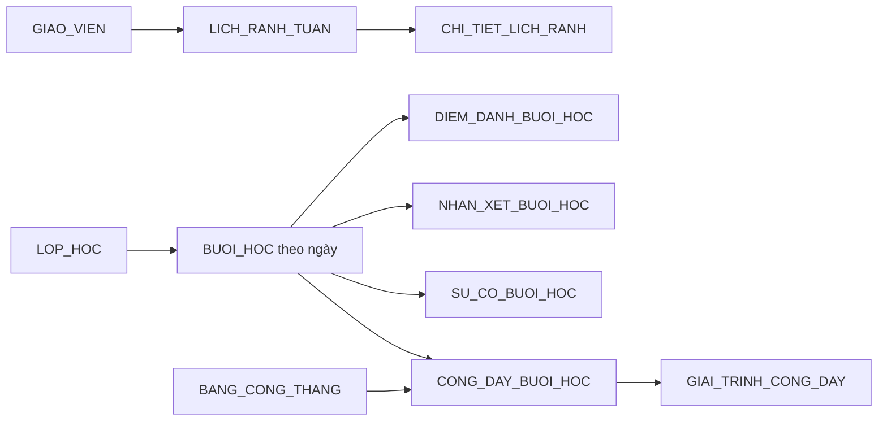

# Lưu nghiệp vụ theo tuần, ngày và ca học

Bộ schema hiện có **31 bảng**, gồm 8 bảng mới cho luồng theo thời gian.

- Database mới: chạy toàn bộ [schema.sql](schema.sql).
- Đã chạy phiên bản 23 bảng: chạy [migration 20261011_timed_workflow.sql](migrations/20261011_timed_workflow.sql).
- Hai cách đều đã kiểm thử chạy lại. Không xóa hay tự chuyển dữ liệu lịch sử JSONB cũ.

## Một mã ca dùng chung



| Bảng mới | Khóa/định danh | Dữ liệu thời gian và liên kết |
| --- | --- | --- |
| LICH_RANH_TUAN | madinhdanh; unique giáo viên + ngày đầu tuần | magiaovien FK; ngaydautuan là thứ Hai; ngaycuoituan tự tính +6 ngày; namhoc; người cập nhật; timestamp |
| CHI_TIET_LICH_RANH | Tuần + ngày + khung giờ | FK tuần/khung giờ; ngày phải trong tuần; free/none. busy tính từ ca đã xếp |
| BUOI_HOC | madinhdanh; unique lớp + ngày + khung giờ | FK lớp/khung giờ/giáo viên chính/cover; ngày DATE; bắt đầu/kết thúc TIMESTAMPTZ; check-in/check-out; người thao tác; học liệu, nhật ký, bản ghi |
| DIEM_DANH_BUOI_HOC | Mã ca + mã học sinh | FK ca/học sinh; present/late/absent; ghi chú; người cập nhật và timestamp |
| NHAN_XET_BUOI_HOC | Mã ca + mã học sinh | FK ca/học sinh; nội dung, tiêu chí, văn phong, lượt AI; người cập nhật và timestamp |
| SU_CO_BUOI_HOC | madinhdanh | FK ca/nhóm sự cố; mã và tên sự cố chụp tại thời điểm báo; trạng thái, người báo/xử lý, giờ báo/xử lý |
| CONG_DAY_BUOI_HOC | madinhdanh; unique mã ca | FK ca/giáo viên/kỳ công; người thực dạy, vai trò, hệ số, ghi chú, trạng thái và giờ gửi |
| GIAI_TRINH_CONG_DAY | madinhdanh | FK bản công; nội dung, metadata minh chứng, người gửi/duyệt, giờ gửi/duyệt, quyết định |

Tên trường đầy đủ, kiểu và ràng buộc nằm trong migration. Mã khung giờ/mã lớp/mã giáo viên trong bảng mới tham chiếu **madinhdanh**, không dùng tên hiển thị; ví dụ SLOT-1 là ID, SLOT-E1 là mã nghiệp vụ của cùng khung giờ.

## Không ghi đè tuần trước

Một giáo viên có một LICH_RANH_TUAN riêng cho mỗi thứ Hai. Mỗi ô lịch có ngày cụ thể, không chỉ thứ trong tuần. Không cho chuyển một lịch tuần cũ sang giáo viên/tuần khác; tạo bản ghi tuần mới.

Mỗi ca có ID riêng và ngày cụ thể. Ví dụ cùng lớp, khung 18:00 ở 06/10 và 13/10 là hai BUOI_HOC khác nhau. Điểm danh/nhận xét dùng mabuoi, không còn key buổi 1/2 làm định danh lịch sử. Nếu cần hiển thị số buổi thì tính số thứ tự riêng.

Giờ TIMESTAMPTZ lưu thời điểm tuyệt đối; ngày nghiệp vụ xác định theo Asia/Bangkok (UTC+7). batdau phải thuộc ngayhoc theo múi giờ này. ketthuc phải sau batdau; hoàn tất cần check-in/check-out hợp lệ.

## Sinh công và đối soát

Khi BUOI_HOC chuyển HOAN_THANH, database tạo kỳ công theo **ngayhoc** (YYYY-MM) nếu chưa có, rồi tạo một CONG_DAY_BUOI_HOC cho giáo viên thực dạy: cover nếu có, giáo viên chính nếu không. Gửi lại cùng ca không nhân đôi công. Không có tháng cố định 2026-09 trong luồng mới.

Chính sách mẫu: một ca có một người nhận công; hệ số mặc định 1 cho ca hoàn tất. Sự cố không tự đặt hệ số 0. Vận hành điều chỉnh hệ số phải ghi lý do; có thể đặt 0 khi được phê duyệt. Ca hủy chưa tự tạo công, để tránh tự áp chính sách trả công chưa được xác định. Nếu nghiệp vụ cho phép một ca trả công nhiều người, cần thay quy tắc unique(mabuoi) và quy trình sinh công.

Kỳ đã khóa chặn sửa ca và các dữ liệu con liên quan. Ca đã có công không được đổi ngày, lớp, khung giờ, người dạy hay trạng thái bằng thao tác thông thường; cần quy trình hiệu chỉnh công riêng. Điều này ngăn âm thầm chuyển công sang tháng/giáo viên khác.

View V_CONG_DAY_THEO_CA nối công với ngày ca, check-in/check-out, giáo viên, cờ có sự cố và cờ có nhận xét. Báo cáo/đối soát dùng nguồn này, không nhập lại công vào mảng JSONB danhsachgiaovien. GIAI_TRINH_CONG_DAY tham chiếu đúng bản công của ca.

Mọi thay đổi ở 8 bảng có ngaytao/ngaycapnhat và nhật ký trước–sau trong NHAT_KY_NGHIEP_VU. Việc phân công cover được giữ trong BUOI_HOC và lịch sử thay đổi, thay vì dùng tên giáo viên để nối bảng.

## Ví dụ hai tuần độc lập

```sql
BEGIN;
INSERT INTO vuihoc."LICH_RANH_TUAN"
 (madinhdanh, magiaovien, ngaydautuan, namhoc)
VALUES
 ('W-GV001-20261005', 'GV-001', '2026-10-05', '2026 - 2027'),
 ('W-GV001-20261012', 'GV-001', '2026-10-12', '2026 - 2027')
ON CONFLICT DO NOTHING;

INSERT INTO vuihoc."CHI_TIET_LICH_RANH"
 (malichtuan, ngay, makhunggio, trangthai)
VALUES
 ('W-GV001-20261005', '2026-10-06', 'SLOT-1', 'free'),
 ('W-GV001-20261012', '2026-10-13', 'SLOT-1', 'none')
ON CONFLICT (malichtuan, ngay, makhunggio)
DO UPDATE SET trangthai=EXCLUDED.trangthai;
COMMIT;
```

## Ví dụ hoàn tất ca và xem công cùng tháng

Các ID ví dụ dưới đây tồn tại trong seed của schema.sql. Dùng ID thực nếu database có dữ liệu khác.

```sql
INSERT INTO vuihoc."BUOI_HOC"
 (madinhdanh, malop, ngayhoc, makhunggio, batdau, ketthuc, magiaovienchinh)
VALUES
 ('DEMO-BUOI-20261006', 'CLS-001', '2026-10-06', 'SLOT-1',
  '2026-10-06T18:00:00+07:00', '2026-10-06T19:30:00+07:00', 'GV-001')
ON CONFLICT DO NOTHING;

UPDATE vuihoc."BUOI_HOC"
SET trangthai='HOAN_THANH',
    vaolopluc='2026-10-06T18:00:00+07:00',
    ketthucluc='2026-10-06T19:30:00+07:00',
    manguoivaolop='GV-001',
    manguoiketthuc='GV-001'
WHERE madinhdanh='DEMO-BUOI-20261006';

SELECT * FROM vuihoc."V_CONG_DAY_THEO_CA"
WHERE mabuoi='DEMO-BUOI-20261006';
-- kycong = 2026-10, magiaovien = GV-001; không phụ thuộc tháng hiện tại.
```

## Ánh xạ cho ứng dụng

src/lib/databaseNames.ts và supabaseMapper.ts có dataset mới:
weekly_availability, availability_slots, dated_lessons, lesson_attendance,
lesson_feedback, lesson_incidents, lesson_credits, credit_disputes.

weekEnd là trường chỉ đọc do SQL tự tính, mapper không gửi trường này khi ghi.

```ts
const row = toSupabaseRow('dated_lessons', {
  classId: 'CLS-001', date: '2026-10-13', timeSlotId: 'SLOT-1',
  startsAt: '2026-10-13T18:00:00+07:00',
  endsAt: '2026-10-13T19:30:00+07:00',
  primaryTeacherId: 'GV-001'
});
// Gửi row tới BUOI_HOC qua backend đã xác thực và kiểm tra quyền.
```

## Phạm vi đã hoàn thành và phần kết nối còn lại

Đã hoàn thành cấu trúc bảng, liên kết FK, trigger kiểm tra tuần/kỳ khóa, tự sinh công, nhật ký, view và mapper. Đã kiểm thử schema mới và migration nâng cấp, hai tuần độc lập, công tháng 10/tháng 11, dạy thay, chống trùng, khóa kỳ, lỗi FK và lý do điều chỉnh.

**Chưa đổi các màn React sang đọc/ghi bảng mới.** Các màn cũ vẫn dùng schedule/activeSessions/CA_HOC và payrollStore trong bộ nhớ; hai hàm cũ còn tháng cố định. Khi tích hợp phải chuyển chúng sang nguồn mới, không đồng thời coi JSONB cũ và bảng mới là hai nguồn chính. Dữ liệu cũ chỉ được di chuyển khi có ngày/ID đầy đủ; không tự suy đoán lịch sử đã bị ghi đè.

RLS của bảng mới bật; chỉ service_role có quyền phía server. Cần Auth/policy/API kiểm tra chủ sở hữu, danh sách học sinh thuộc lớp, quyền người thao tác và tránh xếp lịch trùng giáo viên. Trigger FK không thay thế kiểm tra quyền. Minh chứng hiện có nơi lưu metadata JSONB; nội dung tệp vẫn cần Supabase Storage. Chưa tích hợp luồng duyệt giải trình tự cập nhật hệ số hay gửi bảng công hàng loạt.

## Chạy kiểm tra cục bộ

```powershell
$env:PGLITE_MODULE_PATH = Join-Path $env:TEMP 'vuihoc-sql-validation/node_modules/@electric-sql/pglite'
node_modules/.bin/tsx tests/timedWorkflow.test.ts
node_modules/.bin/tsx tests/databaseContract.test.ts
```

PGLITE_MODULE_PATH cần trỏ tới thư mục cài @electric-sql/pglite. Đây là kiểm tra PostgreSQL cục bộ, chưa nghiệm thu trên project Supabase thật.


Bổ sung bảng thứ 32: BIEN_BAN_DU_GIO có FK bắt buộc tới mã giáo viên. Xem [hướng dẫn](TEACHER_EVALUATIONS.md).
